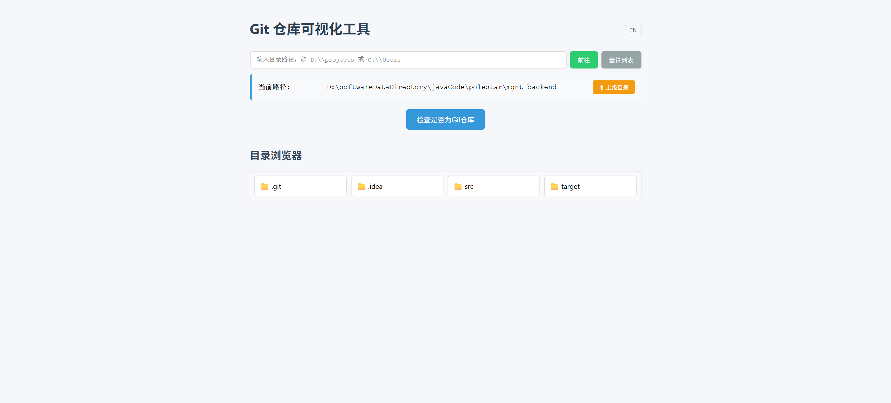
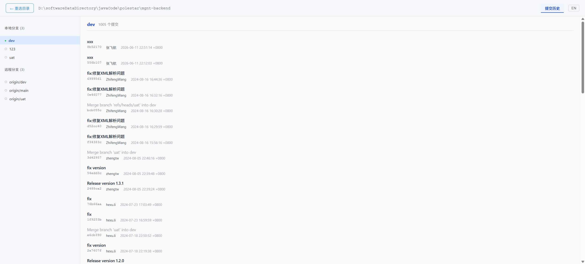

# GitSeeable

[](https://www.npmjs.com/package/gitseeable)
[](https://www.npmjs.com/package/gitseeable)

基于 React 19 + Vite 5（前端）和 Express 5（后端）的全栈 Git 仓库可视化工具。通过直观的 Web 界面浏览本地目录、选择 Git 仓库、管理分支。

## 功能

- **目录浏览器** — 浏览本地文件系统目录，选择要分析的文件夹
- **仓库扫描** — 递归扫描所选目录（最多 3 层）中的 Git 仓库，顶部下拉随时切换
- **分支管理** — 查看本地与远程分支，支持迁出、新建、合并、变基、重命名、删除、推送、更新、比较
- **拉取策略** — 本地与远程有分歧时可选 **变基**（默认）或 **合并**
- **提交历史** — 分页查看提交日志（作者 / 日期 / 提交信息），并支持右键优选、还原、重置、删除提交
- **分支对比** — 比较两个分支的前进/落后提交数，并查看任意提交的完整 diff
- **本地修改** — 「已暂存 / 未暂存」分区 + 批量暂存、取消暂存、回退；左右分栏 diff，默认展示完整上下文、可折叠未修改区域、分隔线可拖拽，预览始终显示工作区最新内容
- **冲突解决** — 内置左右分栏冲突编辑器，支持 merge / rebase / cherry-pick 冲突
- **主题** — 浅色 / 深色两套主题；作为 DeepSeek Harness 插件时自动跟随宿主配色
- **国际化** — 支持中文（默认）和英文
- **会话持久化** — 跨会话记住上次打开的仓库

## 截图

| 目录选择 | 仓库分析 |
|---|---|
|  |  |

## 环境要求

- **Node.js v20.19.3**（其他 v20 版本可能也可以，但仅测试了 v20.19.3）

## 技术栈

| 层 | 技术 |
|---|---|
| **前端** | React 19, Vite 5, Axios, i18next, SweetAlert2, TypeScript |
| **后端** | Express 5, simple-git, TypeScript |
| **模块系统** | 前端 ESM，后端 CommonJS |

## 快速开始

### 全局安装（推荐）

```bash
npm install -g gitseeable
gitseeable
```

打开 http://localhost:3001 即可使用。

### 从源码构建

```bash
# 1. 克隆仓库
git clone https://github.com/fei-hang/gitseeable.git
cd gitseeable

# 2. 确保使用 Node v20.19.3（例如使用 nvm）
nvm use 20.19.3

# 3. 安装依赖（三个独立的 npm install，无 npm workspaces）
npm install
cd client && npm install
cd ../server && npm install

# 4. 生产构建（打包前后端）
cd ..
npm run build

# 5. 启动服务
npm start
# 或
node server/dist/index.js
```

打开 http://localhost:3001 即可使用。

### 开发模式

```bash
# 先安装依赖（见上方「从源码构建」），然后：
npm run dev
```

打开 http://localhost:3000 即可使用。

## DeepSeek Harness 插件（桌面版）

GitSeeable 也可以作为 **DeepSeek Harness** 插件运行：不单独起服务，而是挂进
Harness 的右侧栏，在「**开始**」页里作为一个入口出现。`dsh-plugin/` 就是它。

### 安装

```sh
npm run build:plugin
```

然后用**应用自带的 CLI** 安装——`desktop` 是保留 profile，PATH 上的全局 `dsh`
无权管理它：

```sh
# Windows（路径按默认安装位置）
"D:\softwareInstallationDirectory\deepseekharness\resources\runtime\cli\bin\dsh.cmd" `
  plugin --profile desktop add "D:\path\to\gitseeable\dsh-plugin"

# 上面那条 .cmd 展开后的完整命令
"D:\softwareInstallationDirectory\deepseekharness\DeepSeek Harness.exe" --expose-internals `
  "D:\softwareInstallationDirectory\deepseekharness\resources\app.asar\dsh\node_modules\@deepseek-ai\dsh-desktop-host\lib\cli.js" `
  plugin --profile desktop add "D:\path\to\gitseeable\dsh-plugin"
```

```sh
# macOS / Linux
"/Applications/DeepSeek Harness.app/Contents/MacOS/DeepSeek Harness" --expose-internals \
  "/Applications/DeepSeek Harness.app/Contents/Resources/app.asar/dsh/node_modules/@deepseek-ai/dsh-desktop-host/lib/cli.js" \
  plugin --profile desktop add ~/path/to/gitseeable/dsh-plugin
```

装完**完全退出并重新启动** DeepSeek Harness。

### 使用

1. 打开右侧栏（收起了就先展开）。
2. 在「**开始**」页里点 **GitSeeable**。
3. 页面在当前分栏打开，并直接用**当前会话的工作区**作为起始目录。

也可以用 `Ctrl/Cmd + Shift + G` 打开（宿主已占用该组合键时会静默跳过）。

### 主题

页面跟随 Harness 的主题：**亮对亮、暗对暗**，选「跟随系统」时也一样。
插件里**没有**独立的主题开关——页面首帧从 URL 取配色，之后通过 `postMessage`
实时接收，所以切换 Harness 主题时已经打开的 GitSeeable 面板会立刻换色，
既不重载页面，也不丢失你正在浏览的仓库。

独立运行（`npm start`）时仍保留自己的浅色 / 深色按钮。

### 如果 `dsh plugin add` 报 `ERR_PNPM_MINIMUM_RELEASE_AGE_VIOLATION`

提示是 `@dsh-ops/bash-win32-x64@0.2.1 could not be checked against
minimumReleaseAge (version not present in registry manifest)`。根因是
**registry 镜像不同步**，不是包缺失：该版本在 `registry.npmjs.org` 上存在，
但镜像（如 `registry.npmmirror.com`）还没同步，pnpm 无法确认版本，
整个安装于是失败。让安装走官方 registry：

```sh
".../dsh.cmd" plugin --profile desktop add --registry=https://registry.npmjs.org/ "D:\path\to\dsh-plugin"
```

`--registry` 必须写在 `add` **之后**；`remove` 不接受该参数，需要改用
`pnpm remove -w <name> --config.registry=https://registry.npmjs.org/`。
要只对桌面 profile 长期生效，可在该 profile 目录放一行 `.npmrc`
（见 `dsh-plugin/README.md`）。

## 命令

| 命令 | 说明 |
|---|---|
| `npm run dev` | 同时启动服务端和客户端 |
| `npm run server` | 仅启动后端（端口 3001） |
| `npm run client` | 仅启动前端（端口 3000） |
| `cd client && npm run build` | 客户端生产构建 |
| `cd client && npm run lint` | 运行 ESLint |
| `cd server && npm run dev` | 服务端开发模式 (tsx watch) |
| `cd server && npm run build` | 编译服务端 TypeScript |
| `npm run build:plugin` | 构建前端并把 DeepSeek Harness 插件装配到 `dsh-plugin/` |

## AI 快速启动

你可以把以下提示词分享给 AI 编程助手（Cursor、Claude Code 等），让它自动启动项目。

**方式一：npm 快速安装（推荐）**

> 全局安装 gitseeable 并运行：`npm install -g gitseeable && gitseeable`。打开 http://localhost:3001，用 `Invoke-WebRequest http://localhost:3001/api/drives -Method GET` 验证后端。

**方式二：从源码克隆**

> 克隆 https://github.com/fei-hang/gitseeable.git，然后用 `nvm use 20.19.3` 设置正确的 Node 版本，用 `npm install && cd client && npm install && cd ../server && npm install` 安装依赖。启动开发服务：在 Linux/macOS 上用 `npx tsx server/index.ts &` 和 `npx vite &`，在 Windows 上用 `Start-Job -ScriptBlock { npx tsx server/index.ts }` 和 `Start-Job -ScriptBlock { Set-Location "client"; npx.cmd vite }`。必须后台运行，不要阻塞终端。用 `Invoke-WebRequest http://localhost:3001/api/drives -Method GET` 验证后端，然后打开 http://localhost:3000。

## 许可

ISC
